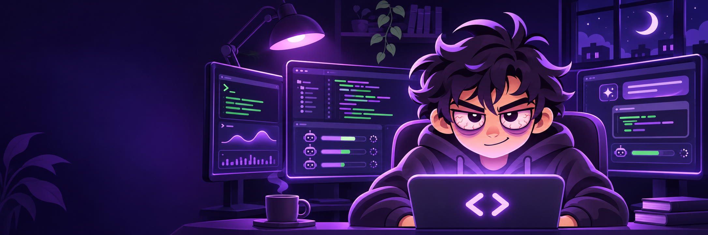
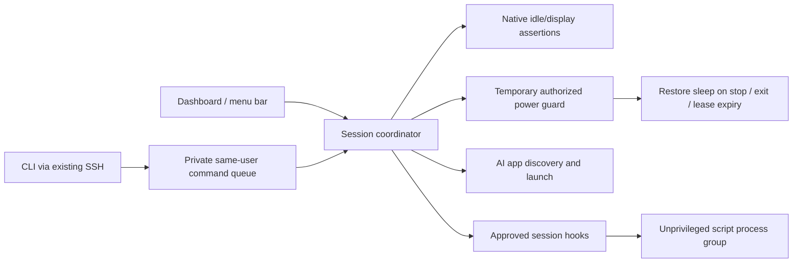

<p align="center">
  
</p>

<h1 align="center">Vibesomnia</h1>
<p align="center"><strong>You can sleep. Your AI doesn't have to.</strong></p>
<p align="center">A native macOS keep-awake utility for the one-more-commit crowd.<br />Close the lid, keep your AI workspace alive, and make the night shift yours.</p>

<p align="center">
  <a href="https://github.com/RaDeleon/Vibesomnia/actions/workflows/ci.yml"></a>
  
  
  
  <a href="LICENSE"></a>
</p>

<p align="center">
  <a href="#why-i-built-vibesomnia">Why I built it</a> ·
  <a href="#get-running">Get running</a> · <a href="#the-night-crew">Features</a> ·
  <a href="#closed-lid-without-amphetamine">Closed lid</a> · <a href="#your-scripts-your-workflow">Add-ons</a> ·
  <a href="#take-it-remote">Remote controls</a> · <a href="docs/PARITY.md">Feature parity</a> ·
  <a href="CHANGELOG.md">Changelog</a>
</p>

> **V1.0 Beta 1, fully open source.** This is a beta test release, not a finished
> Amphetamine replacement yet. The standalone closed-lid guard and script system
> are implemented; the [parity checklist](docs/PARITY.md) shows what still needs work.
> Community/Pro editions and monetization are deferred. No paywalls or license checks.

**[Download V1.0 Beta 1 — DMG installer](https://github.com/RaDeleon/Vibesomnia/releases/tag/v1.0.0-beta.1)** · [All releases](https://github.com/RaDeleon/Vibesomnia/releases)

App version **1.0.0-beta.1** includes verified closed-lid status and immediate
on/off controls. The GitHub release is marked **Latest** for download visibility;
it remains beta software with the limitations below.

## Why I built Vibesomnia

I keep my MacBook docked a lot, but I don't always want to sit at the desk to
keep coding. When I'm away from home, I use my phone to work with ChatGPT,
Claude Code, and desktop AI apps on the Mac. I also use my agentic browser,
BrowserRAD, to handle browser work and tasks. The MacBook at home is still the
machine doing the work.

The problem was sleep. If the Mac sat idle long enough, it would go to sleep
and interrupt what I was doing remotely. Claude Code would time out, and I'd
lose the session. Being away from the keyboard didn't mean I was done working,
but the machine treated it that way.

I built Vibesomnia so I could close the lid, work from my phone while doing
other things, and keep my AI tools coding and controlling the computer. The
same need comes up at night: start a task before bed, shut the lid, and keep
idle sleep from cutting the run short.

Vibesomnia keeps the Mac awake underneath that workflow. My existing remote
access tools provide the connection from my phone; ChatGPT, Claude, and
BrowserRAD handle the tasks.

**You can sleep. Your AI doesn't have to.**

## Built for the nights that become mornings

Use the display normally, let it go dark, or opt into closed-lid mode. Start a
manual, timed, or app-aware session, and end it when you're done.

The goal is the power and flexibility of an Amphetamine-class utility, built
around AI development: clear session controls, useful app awareness, your own
scripts, and access through the remote tools you already use.

## The night crew

| Capability | What V1.0 Beta 1 does |
| --- | --- |
| **On your terms** | Manual, timed, indefinite, and selected-GUI-app sessions |
| **Lights out, work on** | Native idle-sleep prevention, with optional display wakefulness |
| **Closed lid, standalone** | Bundled administrator-authorized power guard; no Amphetamine installation |
| **Cleanup that outlives the app** | Separate guard monitors process identity and an eight-second heartbeat lease |
| **Ready to install** | Universal DMG, macOS installer, and first-run setup with saved preferences |
| **Know your tools** | Detect/open Claude Desktop, ChatGPT, and Codex; launch Claude Code/Codex CLI in Terminal |
| **App-aware sessions** | End when the selected app closes; opt into starting when it runs |
| **Battery guard** | Refuse/end sessions at 20% or lower on battery, configurable in Settings |
| **Your own scripts** | In-app source editor, add-on import, reviewed versions, manual runs, start/end hooks |
| **Take control elsewhere** | Same-user CLI commands through an existing SSH connection |

Closing the dashboard leaves the menu bar controls available. `⌘⇧S` toggles the
session while Vibesomnia is focused; it is not a global hotkey yet.

## Get running

### Install the app

The beta has a **universal DMG containing a macOS installer**.
Open `Install Vibesomnia.pkg`, install to Applications, then launch Vibesomnia.
First-run setup detects AI apps, saves your sleep preferences, and walks through
an optional lid/remote test. Reopen the guide from the toolbar or Settings.

- macOS 14+ on Apple silicon or Intel. No developer tools needed to use the app.
- End/recover an existing session and quit Vibesomnia before installing an update.
- Administrator approval for the Applications installation and closed-lid sessions.
- Existing SSH or screen-sharing access for remote use; setup does not enable it.
- No model account, API key, or third-party Swift dependency.

**Unsigned beta installer.** The app is ad-hoc signed; its installer is unsigned
and not notarized. macOS may block the download. Developer ID signing, notarization,
clean-Mac installation, Intel hardware and repeat-cycle remote testing remain open.
The owner approved the beta milestone; that decision does not turn pending tests
into verified results.

### Build from source

Contributors need Xcode 15+ or a compatible Swift 5.9+ toolchain.

```sh
git clone https://github.com/RaDeleon/Vibesomnia.git
cd Vibesomnia
./script/build_and_run.sh --verify
```

This builds and ad-hoc signs `dist/Vibesomnia.app`, launches it, and checks the
CLI. The Codex **Run** button uses the same script. The installer pipeline is documented in [distribution](docs/DISTRIBUTION.md);
there is no public notarized release or Mac App Store package yet.

1. Leave **Let the display sleep** enabled for a dark screen and an awake Mac.
2. Choose a timer or keep the session indefinite. Optionally select a running app.
3. Turn on **Keep running with lid closed** to start protected mode immediately,
   or use **Start session** with your saved default from Settings.
4. Approve the macOS administrator prompt for closed-lid mode.
5. End the session from the dashboard, menu bar, or CLI to restore normal behavior.

Other apps and pre-existing macOS power preferences may still prevent idle sleep
after Vibesomnia stops; it releases its own assertions and override.

<details>
<summary><strong>Build, test, debug, and regenerate icons</strong></summary>

```sh
swift test
./script/build_and_run.sh --build-only
./script/build_and_run.sh --logs
./script/generate_icon.sh
```

`./script/smoke_test.py` exercises native assertions and graceful CLI quit against
an idle running app, then leaves it closed. Python 3 is required for that test.
The build script requests a graceful quit before rebuilding; resolve recovery
rather than force-killing an app that owns an active session.

</details>

## Closed lid without Amphetamine

The dashboard’s **Keep running with lid closed** switch shows verified protection
and changes the current session immediately. Turning it on starts a session if
needed and requests administrator approval. Turning it off keeps native idle-sleep
prevention running, preserving your timer and app condition. End the session to
stop both. Settings and setup offer a separate default for new sessions.

The app and guard recheck macOS power state every second. If the override is
cleared, the switch turns off and the session ends with an error; Vibesomnia does
not silently reapply the setting. CLI status includes `closedLidActive` and
`closedLidVerifiedAt`. These checks verify power state, not remote connectivity.

Closed-lid mode now belongs to Vibesomnia. Ordinary sessions use IOKit power
assertions; closed-lid sessions additionally use **VibesomniaPowerGuard**, a
small helper included in the app bundle.

- macOS asks for administrator authorization when the guard starts.
- The guard refuses to overwrite an already-disabled system sleep setting.
- It records ownership before changing the system-wide sleep override.
- It checks the app's process identity and fresh heartbeat sequence.
- Stop, app exit, or an expired lease restores sleep before removing the record.
- It installs no persistent service, login daemon, sudoers rule, or network port.
- It cannot run add-ons, execute user commands, or enable remote access.

While this mode is on, system sleep is disabled, including manual sleep requests;
**end the session to restore normal system sleep**. Display sleep remains
independent. Opening the lid doesn't end the session, so you can close it again.
Keep an awake Mac on a ventilated surface, not inside a bag.

**Validation:** activation, normal stop, and restoration after simulated app exit
have been tested locally with Amphetamine's session ended. Physical lid-close /
open / reclose, charger transitions, and reconnection from another device still
need [hardware acceptance testing](docs/TESTING.md). Compatibility is alpha-stage;
Mac App Store suitability is not established.

If the root guard itself fails before restoring sleep, Vibesomnia exposes explicit
administrator-authorized recovery from its root-owned record. The complete
ownership and failure model is in [closed-lid design](docs/CLOSED_LID.md).

## Your scripts, your workflow

Open **Settings → Add-ons** to create a script, import a folder, edit its source
and manifest, review it, and approve that exact version. Edits invalidate approval.
Nothing imported or bundled runs automatically before you approve and enable it.

| Idea | What an add-on could do |
| --- | --- |
| **Workspace pulse** | Show local power assertions, time, and uptime. Included example. |
| **End-of-shift chime** | Play a macOS sound when a session ends. Included example. |
| **Project test runner** | Run your chosen project's test command after you start a session. |
| **Git checkpoint** | Show branch/status or write a local summary before you step away. |
| **Night crew launcher** | Open your selected editor, terminals, projects, and AI apps. |
| **Personal finish ritual** | Send a local notification, export a report, or run your backup script. |

The example add-ons are opt-in. Other ideas are examples of scripts **you author**,
not automatic integrations or permission to send data elsewhere.

Shell (zsh/bash), AppleScript, and Python 3 are supported. Scripts run as your user,
with a reviewed-content snapshot, clean environment, 1–300 second timeout,
process-group cleanup, and a 64 KiB captured-output limit. They are **trusted local
code, not sandboxed plug-ins**: they can use your account's files and network.
Long-lived daemons/background agents are outside the add-on lifecycle contract.

See the [add-on guide](docs/ADDONS.md) for manifests, events, examples, and guardrails.
There is no remote arbitrary-script endpoint or automatic marketplace installer.

## Take it remote

The bundle contains `Contents/MacOS/vibesomnia-cli`. Use **Copy CLI path** in the
app to find your exact build path.

```sh
CLI="$(pwd)/dist/Vibesomnia.app/Contents/MacOS/vibesomnia-cli"
"$CLI" status
"$CLI" start --minutes 60
"$CLI" stop
"$CLI" start --while-app com.anthropic.claudefordesktop
"$CLI" launch claude
"$CLI" launch claude-code
"$CLI" start --closed-lid
"$CLI" --help
```

From another device, with SSH already configured:

```sh
ssh your-mac '/absolute/path/to/vibesomnia-cli status'
ssh your-mac '/absolute/path/to/vibesomnia-cli start --minutes 60'
ssh your-mac '/absolute/path/to/vibesomnia-cli stop'
```

The app must run in the **same user's logged-in graphical session**. Starting a
closed-lid session requires administrator interaction on that Mac; authorize it
locally before leaving. Remote start is not an unattended privilege bypass.

**Session controls are implemented; remote desktop is not.** Use your existing
screen-sharing tool to interact with Claude/ChatGPT/Codex windows. Vibesomnia does
not enable SSH, install keys, bypass screen locking, stream the screen, inject
input, relay chats, or attach to terminal agent sessions. It keeps the host awake
so your existing remote connection has a running machine to reach.

## How the pieces fit



| Location | Responsibility |
| --- | --- |
| `Sources/VibesomniaCore/` | Session policy, lease logic, manifests, script runner, local control protocol |
| `Sources/Vibesomnia/` | SwiftUI screens, session coordinator, platform services, add-on management |
| `Sources/VibesomniaPowerGuard/` | Fixed-purpose temporary elevated worker and recovery |
| `Sources/VibeSystem/` | Small C bridge for process identity, signals, and isolated script spawning |
| `Sources/VibesomniaCLI/` | Typed command-line client |
| `Resources/` | Mascot artwork, macOS icon, and opt-in example add-ons |
| `Tests/`, `script/` | Policy/runtime checks and reproducible local builds |

<details>
<summary><strong>Privacy, local data, and permissions</strong></summary>

No analytics uploads, model credentials, chat content, or prompts are collected.
GUI app discovery checks running bundles, registered apps, and Applications folders,
using bundle IDs and app names together; CLI discovery checks common executable paths.
It does not imply a model is authenticated or a CLI agent is actively working.

Same-user status, leases, and short-lived requests live under
`~/Library/Application Support/Vibesomnia/Control/` (`0700` directory, `0600` files).
User add-ons live alongside it in `AddOns/`; approval hashes are stored in app
preferences. Activity is shown locally; macOS unified logs record transitions and
errors. Script output stays in the local result pane unless your script itself
writes or transmits it.

The temporary guard's root-owned recovery state lives in
`/private/var/run/vibesomnia-closed-lid/` only while active or awaiting recovery.
It never reads add-on code or credentials. Native assertions are released by
macOS if the app exits. Display sleep, closed-lid preference, battery protection, and setup completion
persist. Active sessions, timers, selected-app rules, and auto-start triggers do
not resume on relaunch. Add-on approvals and enabled choices persist.

</details>

## Road to the full replacement

[Feature parity](docs/PARITY.md) tracks every category from Amphetamine's published
feature list, including schedules, downloads, network/device triggers, screen
saver and lock policies, Drive Alive, global hotkeys, customization, and scripting.
A checked item means implemented; test evidence and remaining limitations stay
separate. Beta requires owner approval and the [acceptance gates](docs/ROADMAP.md).

[Contributing](CONTRIBUTING.md) · [Development diary](docs/dev-diary/README.md) · [Development sessions](sessions.log) ·
[Release history](CHANGELOG.md) · [Agent instructions](AGENTS.md) · [Claude guidance](CLAUDE.md)

## Artwork, license, and support

The mascot and matching night-workstation banner are original generated artwork.
Sources, exports, prompts, and provenance: [icon](Resources/ARTWORK.md) /
[banner](docs/assets/BANNER.md). Screens in the banner are illustration, not a UI
screenshot or evidence of implemented chat/agent integrations.

Copyright © 2026 **Angelo De Leon**. [GNU AGPL v3.0](LICENSE), `AGPL-3.0-only`.
Preserve required notices. Commercial use is permitted under the license;
compliant open-source use does not require royalty payments.

Inspired by Amphetamine and the keep-awake utility category. No Amphetamine
installation, code, assets, or Power Protect component is used by this version.

**Support the night shift:** star the repo, report reproducible issues, or help
with the hardware test checklist. Donation links will be added when the support
destination is ready. There is no paid edition in the current alpha.
