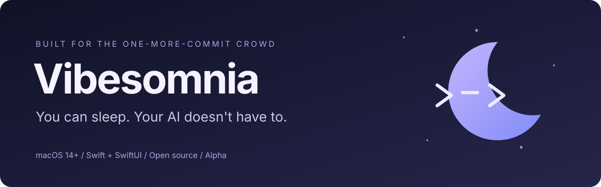
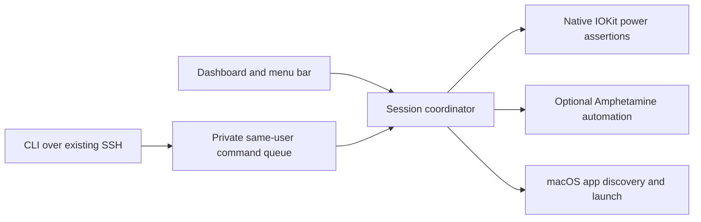

<p align="center">
  
</p>

<p align="center">
  <a href="https://github.com/RaDeleon/Vibesomnia/actions/workflows/ci.yml"></a>
  
  
  <a href="LICENSE"></a>
</p>

<p align="center">
  <strong>A little less screen glow. A little more work getting done.</strong><br />
  Keep your Mac awake, launch your AI tools, and control sessions from elsewhere.
</p>

<p align="center">
  <a href="#get-running">Get running</a> ·
  <a href="#what-works-in-this-alpha">Features</a> ·
  <a href="#remote-controls">Remote controls</a> ·
  <a href="docs/ROADMAP.md">Roadmap</a> ·
  <a href="CHANGELOG.md">Changelog</a> ·
  <a href="CONTRIBUTING.md">Contribute</a>
</p>

## For the nights that become mornings

Vibesomnia is a native macOS menu bar app for developers who work with Claude,
ChatGPT, Codex, and terminal agents. Start a session, let the display go dark,
and keep your workspace available. End it when you're done.

The destination is an Amphetamine-style power utility with AI workspace controls
and remote access built around real development workflows. **This first alpha
implements the foundation, not full Amphetamine feature parity.**

**Current version: `0.1.0-alpha.1`.** Everything in this repository is open source.
Community/Pro editions, licensing infrastructure, and paywalls are deferred.
Beta starts when the core workflow is reliable and approved for that milestone.

## What works in this alpha

| Capability | Implementation |
| --- | --- |
| Manual on/off sessions | Dashboard, menu bar, keyboard shortcut, or CLI |
| Indefinite and timed sessions | One minute to seven days, or until stopped |
| Screen-off keep-awake | Native macOS power assertions; display sleep allowed by default |
| Keep the display on | Optional assertion for presentations or monitoring |
| While-app-running sessions | Ends when the selected GUI app closes |
| App-aware auto-start | Opt-in trigger for the selected GUI app; manual stop suppresses retriggering until that app closes |
| Battery protection | Refuses/ends sessions at 20% or lower on battery; can be disabled in Settings |
| AI workspace | Detects and opens installed Claude Desktop, ChatGPT, and Codex |
| Terminal agents | Detects common Claude Code/Codex CLI installations; opens them in Terminal |
| Remote session commands | Same-user CLI over an existing SSH connection |
| Closed-lid sessions | **Optional Amphetamine backend**, described below |
| Session recovery | Explicit recovery after an interrupted Amphetamine-backed session |

### Closed lid: read this first

**Native mode prevents idle sleep. It does not override macOS lid-close sleep.**
For closed-lid operation in this alpha, install
[Amphetamine](https://apps.apple.com/app/amphetamine/id937984704) in `/Applications`,
configure its closed-display support, and enable **Keep running with lid closed**
in Vibesomnia. macOS may request Automation approval. Apple Silicon power-source
changes may require Amphetamine's own Power Protect setup.

Vibesomnia uses Amphetamine's published AppleScript commands; it contains no
Amphetamine source and is not affiliated with that project. It refuses to replace
an already-active Amphetamine session. End that session yourself first.

During a Vibesomnia closed-lid session, reopening the lid does not end the session.
Closing it again should retain the same behavior until you end the session.
Physical lid-close, charger-change, and remote-reconnection behavior still require
hardware testing. Keep an awake Mac ventilated; don't place it in a bag.

A standalone, recoverable closed-lid implementation is on the
[roadmap](docs/ROADMAP.md). This app does not silently install a root helper,
change sudoers, or permanently change your power settings.

## Get running

### Requirements

- macOS 14 or newer.
- Xcode 15+ or a compatible Swift 5.9+ toolchain; active developer tools selected.
- Optional: Amphetamine for closed-lid mode; existing SSH access for remote commands.
- No API keys, Node runtime, cloud account, or third-party Swift packages.

```sh
git clone https://github.com/RaDeleon/Vibesomnia.git
cd Vibesomnia
./script/build_and_run.sh --verify
```

This builds and ad-hoc signs `dist/Vibesomnia.app`, launches it, and checks that
its CLI is responding. The Codex **Run** action uses the same script.
The dashboard and menu bar item both control the same session.
Closing the dashboard leaves the app in the menu bar. Quitting ends its session.

1. Start with **Let the display sleep** enabled and closed-lid mode disabled.
2. Choose an indefinite session or a timer. Optionally select a running GUI app.
3. Click **Start session**. Use **Display off now** to test screen-off behavior.
4. Click **End session** when finished. Other applications and macOS settings may
   still keep the machine awake; Vibesomnia releases only what it owns.

`⌘⇧S` toggles a session while the app is focused; it is not a global hotkey.

### Build and test

```sh
swift test
./script/build_and_run.sh --build-only
./script/build_and_run.sh --logs
```

The build script requests a graceful quit before rebuilding. If a prior session
needs recovery, resolve it in the app rather than force-killing the process.
Local builds are **not Developer ID signed or notarized**. No public DMG or
Mac App Store release is published as part of this alpha.

## Remote controls

The app bundle includes `Contents/MacOS/vibesomnia-cli`.
Use **Copy CLI path** in the dashboard to find your build's exact location.

```sh
CLI="$(pwd)/dist/Vibesomnia.app/Contents/MacOS/vibesomnia-cli"
"$CLI" status
"$CLI" start --minutes 60
"$CLI" stop
"$CLI" start --while-app com.anthropic.claudefordesktop
"$CLI" launch claude
"$CLI" launch claude-code
"$CLI" start --closed-lid
"$CLI" --help
```

On another device, use your existing SSH setup and the Mac's actual CLI path:

```sh
ssh your-mac '/absolute/path/to/vibesomnia-cli status'
ssh your-mac '/absolute/path/to/vibesomnia-cli start --minutes 60'
ssh your-mac '/absolute/path/to/vibesomnia-cli stop'
```

Vibesomnia must be running in the **same user's logged-in graphical session**.
It does not enable Remote Login, install SSH keys, open firewall ports, bypass
screen locking, or survive logout/reboot as a background service. The controls
use local files with a private directory and short-lived requests. SSH supplies
the remote authentication and transport.

**These are session and app-launch controls, not full remote desktop.** There is
no chat relay, screen streaming, keyboard/mouse injection, or mobile companion in
this alpha. Use an existing desktop-sharing tool for full GUI interaction.
Launching a CLI opens Terminal; it does not remotely attach to an agent session.

## Under the hood



| Location | Responsibility |
| --- | --- |
| `Sources/VibesomniaCore/` | Session policy, typed command protocol, local transport |
| `Sources/Vibesomnia/App/` | App lifecycle, scenes, graceful shutdown |
| `Sources/Vibesomnia/Stores/` | Shared session state and command coordination |
| `Sources/Vibesomnia/Services/` | Power, battery, AI app discovery, optional automation |
| `Sources/Vibesomnia/Views/` | Dashboard, menu bar, settings |
| `Sources/VibesomniaCLI/` | Command-line client |
| `Tests/` | Expiry, app-lifetime, validation, and transport tests |
| `script/` | Reproducible app bundle build and launch |

### Privacy and recovery

- No analytics, telemetry uploads, model credentials, or conversation access.
- CLI status and short-lived commands live under
  `~/Library/Application Support/Vibesomnia/Control/` (directory `0700`, files `0600`).
- GUI app detection uses bundle identifiers. CLI detection checks common executable
  locations; CLI process/activity detection is not implemented.
- The activity panel is in-memory. macOS unified logs contain session transitions
  and errors; no prompts or chat contents are collected.
- Native assertions are released by macOS if the process exits.
- An interrupted Amphetamine session can remain active. Next launch offers
  **Recover session**, which explicitly ends the current Amphetamine session.
  This could include a session you started independently after the interruption.
- Session options and triggers reset on app relaunch in this alpha. There is no
  automatic login item or unattended resumption.

## What's next

The [roadmap](docs/ROADMAP.md) tracks native closed-lid support, advanced triggers,
file/download sessions, schedules, app parity, secure remote desktop exploration,
accessibility, packaging, and the acceptance gates for beta.

Development history lives in [sessions.log](sessions.log). Versioned changes live
in [CHANGELOG.md](CHANGELOG.md). Contributor and agent instructions are in
[CONTRIBUTING.md](CONTRIBUTING.md), [AGENTS.md](AGENTS.md), and [CLAUDE.md](CLAUDE.md).

## License and credits

Copyright © 2026 **Angelo De Leon**. Licensed under
[GNU AGPL v3.0](LICENSE), `AGPL-3.0-only`. Preserve required copyright and license
notices when redistributing. Commercial use is permitted under the license;
this project does not require royalties for compliant Community use.

Inspired by the keep-awake utility category, including Amphetamine. The optional
integration requires a separate installation and follows that app's own terms.

Want to support development? Star the repo, report reproducible issues, and help
exercise the [manual test checklist](docs/TESTING.md). Funding links can be added
when the project's support destination is ready.
